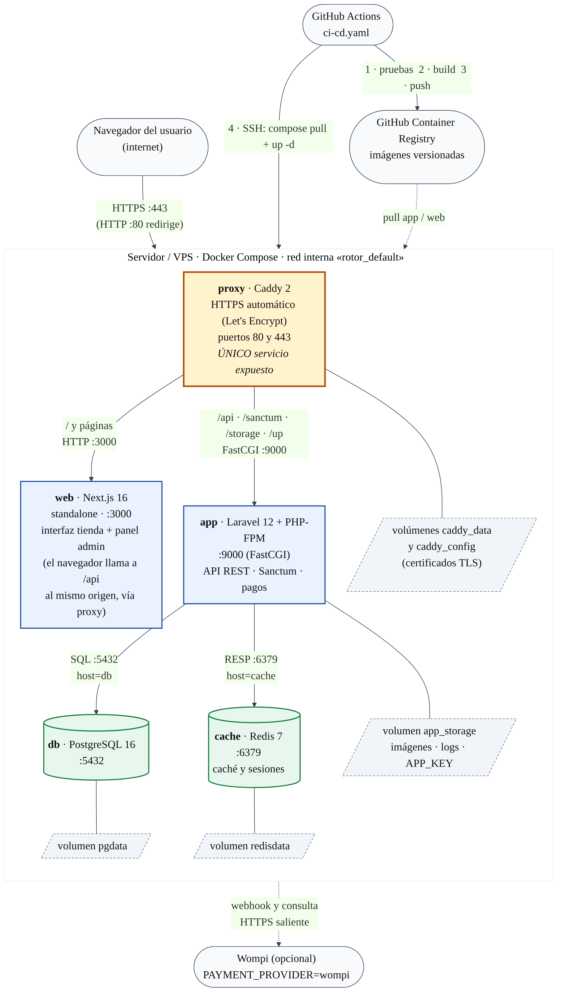

https://srv2153504.hstgr.cloud

# Proyecto Rotor

Prototipo transaccional de comercio electrónico para inventario industrial.

**Prototipo E2:** https://rama-0611.github.io/cedar-harbor/web/

**Código fuente:** https://github.com/RAMA-0611/cedar-harbor

**Proyecto Rotor** es una iniciativa de software impulsada por el equipo **ByteBlade** para construir un flujo transaccional de comercio electrónico orientado a entornos industriales.

El repositorio contiene el trabajo colaborativo del proyecto. La organización aliada del sector industrial, ubicada en Casanare (Colombia), no se identifica públicamente por confidencialidad.

| Dato académico | Valor |
|---|---|
| Ruta | F — Comercio electrónico y pasarelas de pago |
| Equipo | ByteBlade |
| Grupo | 2 |
| Curso | Tecnologías Web |
| Periodo | 2026-B |

---

## Entrega 4 — Contenerización, despliegue público y CI/CD



### Arranque con un solo comando

Requisitos: Docker Engine / Docker Desktop con **Compose ≥ 2.24** (`docker compose version`). No hace falta crear `.env`: el
`compose.yaml` trae valores **solo de desarrollo**.

```bash
git clone https://github.com/RAMA-0611/cedar-harbor.git Rotor
cd Rotor
docker compose up -d --build
```

Cuando `docker compose ps` muestre todos los servicios en `healthy`, abra **http://localhost:8080** (tienda) y
**http://localhost:8080/login** (panel). Al primer arranque se crean las tablas, el catálogo de demostración y el primer
administrador. Si no definió `ADMIN_PASSWORD`, la contraseña se genera y se imprime **una sola vez**:

```bash
docker compose logs app | grep "Contraseña generada"      # Linux / macOS / Git Bash
docker compose logs app | Select-String "Contraseña generada"   # PowerShell
```

Apagar conservando datos: `docker compose down`. Borrar también los datos: `docker compose down -v`.

### Servicios

| Servicio | Imagen / rol | Healthcheck |
|---|---|---|
| `proxy` | Caddy 2 — único puerto expuesto (80/443), HTTPS automático, enruta `/api`, `/sanctum`, `/storage`, `/up` a la API y el resto a la web | `wget` a `/up` |
| `app` | Laravel 12 + PHP-FPM 8.3 | `php-fpm` responde en `:9000` y `/up` |
| `web` | Next.js 16 (standalone) | HTTP 200 en `:3000` |
| `db` | PostgreSQL 16, volumen `pgdata` | `pg_isready` |
| `cache` | Redis 7, volumen `redisdata` | `redis-cli ping` |

La base de datos y Redis **no** se publican al host. Los volúmenes (`pgdata`, `redisdata`, `app_storage`, `caddy_data`) conservan
los datos al reiniciar o recrear contenedores.

### Variables de entorno

Plantilla completa en [`.env.example`](.env.example). Nunca versione `.env`.

| Variable | Obligatoria en producción | Descripción |
|---|---|---|
| `SITE_ADDRESS` | Sí | Dominio público (p. ej. `rotor.midominio.com`); con dominio Caddy obtiene el certificado. `localhost` en desarrollo |
| `APP_URL` | Sí | `https://` + dominio |
| `POSTGRES_PASSWORD` | Sí | Contraseña de la base (el compose de producción falla si falta) |
| `SANCTUM_STATEFUL_DOMAINS` | Sí | El dominio sin `https://` (necesario para la sesión por cookie) |
| `APP_KEY` | Sí en producción | `base64:` + `openssl rand -base64 32`. En desarrollo se genera sola y se guarda en el volumen `app_storage` |
| `ADMIN_EMAIL` / `ADMIN_PASSWORD` | Sí en producción | Primer administrador. En desarrollo, sin contraseña, se genera y se imprime una vez |
| `PAYMENT_PROVIDER` | No | `simulated` (por defecto) o `wompi` |
| `WOMPI_*` | Solo con `wompi` | Llaves sandbox de Wompi |

### Pasarela de pago simulada

Con `PAYMENT_PROVIDER=simulated` el checkout redirige a una pantalla de pago con el flujo completo. Tarjetas de prueba
(cualquier fecha futura y CVC de 3 dígitos):

| Tarjeta | Resultado |
|---|---|
| 4242 4242 4242 4242 | Aprobada → pedido `PAID`, stock consumido |
| 4000 0000 0000 0002 | Rechazada → pedido `FAILED`, reserva liberada |
| 4000 0000 0000 9995 | Fondos insuficientes → `FAILED` |
| 4000 0000 0000 0119 | Error de la pasarela → `FAILED` |
| 4000 0000 0000 3220 | Pendiente → se resuelve con los botones «Aprobar / Rechazar» |

No se almacenan números de tarjeta (solo los últimos 4 dígitos).

### Despliegue y reversión

1. Prepare un servidor con Docker, abra los puertos 80 y 443 y apunte el DNS del dominio a su IP.
2. Cree en GitHub los *secrets* `DEPLOY_HOST`, `DEPLOY_USER`, `DEPLOY_SSH_KEY`, `DEPLOY_PATH`, `GHCR_PULL_TOKEN` y la
   *variable* `PUBLIC_URL` (detalle en [`docs/guia-despliegue.md`](docs/guia-despliegue.md)); cree el `.env` de producción
   **directamente en el servidor**, nunca en el repositorio.
3. Un *push* a `main` ejecuta `.github/workflows/ci-cd.yaml`: pruebas → construcción y publicación en GHCR → despliegue por SSH
   → espera a `healthy` → verificación de `PUBLIC_URL`. Si una prueba falla, **no se construye ni se despliega**.
4. **Reversión:** *Actions → CI-CD → Run workflow* indicando `image_tag` (p. ej. `sha-1a2b3c4` o `v0.4.0`).

### Documentación de la entrega

- [`docs/arquitectura-despliegue.png`](docs/arquitectura-despliegue.png) — diagrama de arquitectura
- [`docs/informe-rendimiento.md`](docs/informe-rendimiento.md) — Lighthouse antes / después
- [`docs/decisiones.md`](docs/decisiones.md) — decisiones técnicas (ADR-E4-001 a 007)

### Estado de la Entrega 4

| Elemento | Estado |
|---|---|
| Validaciones de formularios (teléfono, documento, nombre, contraseña, producto, carrito) | Implementado, con pruebas de backend y de navegador |
| Pasarela de pago simulada (aprobada, rechazada, fondos insuficientes, error, pendiente) | Implementado |
| Diseño adaptable (teléfonos Android, tableta y escritorio) | Implementado; prueba automática en `frontend/e2e/mobile-android.spec.ts` |
| Dockerfile multietapa, `compose.yaml`, healthchecks, volúmenes, `.dockerignore` | Implementado |
| Flujo CI/CD con imágenes versionadas en GHCR y despliegue por SSH | Implementado en `.github/workflows/ci-cd.yaml` |
| Diagrama de arquitectura e informe de rendimiento | En `docs/` |
| Pendiente para la Entrega 5 | Renderizado del catálogo en el servidor para bajar el LCP, reducción de JavaScript sin usar y lo que defina la especificación de esa entrega |

---

## Description

Proyecto Rotor conecta la disponibilidad de inventario con un catálogo web y un ciclo de compra digital, de modo que la intención de compra se traduzca en una orden consistente, un pago sandbox verificable y una conciliación auditable.

El alcance público del proyecto se centra en la capa transaccional: catálogo, carrito, checkout, órdenes, pasarela sandbox, webhooks y estados de orden.

---

## Problem

Una organización del sector industrial administra un volumen importante de materiales, repuestos, componentes, herramientas y equipos.

Parte de dicho inventario tiene valor comercial y puede publicarse mediante un catálogo web. Sin un flujo transaccional completo, la publicación comercial queda limitada a la consulta o a la solicitud de cotización, sin cerrar de forma confiable la cadena:

**inventario → publicación → intención de compra → compra → pago → conciliación**

Proyecto Rotor aborda esa brecha.

---

## Objective

Desarrollar un flujo transaccional de comercio electrónico que conecte:

```text
Inventario
  → Catálogo
  → Carrito
  → Checkout
  → Orden
  → Pasarela de pago (sandbox)
  → Webhook
  → Confirmación
  → Conciliación
```

El sistema debe mantener consistencia entre stock, orden y estado del pago, con validaciones, reservas temporales e idempotencia en los puntos críticos.

---

## Project status

### Estado actual — v0.5.0

Tag: [`v0.5.0`](https://github.com/RAMA-0611/cedar-harbor/releases/tag/v0.5.0) · Frontend: Next.js / React · Backend: Laravel 12 · DB: PostgreSQL · Auth: Sanctum (sesión/cookies + CSRF + roles).

`web/` permanece **Historical E2 only**. La aplicación vigente es `frontend/` + `backend/`.

| Componente | Estado |
|---|---|
| Storefront Next.js (`/`) | IMPLEMENTADO / INTEGRADO |
| Registro CUSTOMER (`/cliente/registro`) | IMPLEMENTADO |
| Catálogo público | API real (PostgreSQL) |
| Carrito | IMPLEMENTADO / PostgreSQL |
| Checkout | IMPLEMENTADO |
| Órdenes | IMPLEMENTADO |
| Imágenes de producto | IMPLEMENTADO (`image_path` + storage público) |
| ADMIN ↔ tienda sync | PASS (misma API / misma DB) |
| Payment intent Wompi Sandbox | IMPLEMENTADO |
| Webhook firmado Wompi | IMPLEMENTADO / LIVE VALIDATED |
| Conciliación (`reconcile`) | IMPLEMENTADO / LIVE VALIDATED |
| Exactly-once stock settlement | PASS |
| LIVE Wompi Sandbox | PASS |
| issue #9 | CLOSED / estado:hecho |
| issue #44 | CLOSED / estado:hecho |

Flujo real validado:

```text
Catálogo → registro/login CUSTOMER → carrito → checkout → orden
  → Wompi Sandbox → webhook firmado → PAID → reserva CONSUMED
  → stock → reconcile
```

ADMIN: Dashboard, Usuarios, Categorías, Productos (incl. imágenes), Pedidos.

Evidencia LIVE (no sensible): `LIVE_WOMPI_SANDBOX=PASS`, `LIVE_WEBHOOK_RECEIVED=PASS`, `LIVE_WEBHOOK_SIGNATURE=PASS`, `LIVE_RECONCILE=PASS`, `LIVE_EXACTLY_ONCE=PASS`, `LIVE_ADMIN_PUBLIC_SYNC=PASS`.

Los pagos están validados exclusivamente contra **Wompi Sandbox**. Project Rotor **no** procesa dinero de producción.

La interfaz `/pedidos` cubre listado, detalle, actualización de contacto/entrega, cancelación y eliminación controlada. **CREATE** sigue siendo el flujo transaccional `CUSTOMER` (`carrito → checkout → POST /api/orders`). No existe `POST /api/admin/orders`.

Matriz, guion de demo y evidencia: [`docs/evidence/MVP_FINAL_REQUIREMENTS_MATRIX.md`](./docs/evidence/MVP_FINAL_REQUIREMENTS_MATRIX.md), [`docs/evidence/MVP_FINAL_DEMO_SCRIPT.md`](./docs/evidence/MVP_FINAL_DEMO_SCRIPT.md), [`docs/evidence/mvp7-final-validation.md`](./docs/evidence/mvp7-final-validation.md).

### Snapshot histórico — cierre Entrega 2

> Estado **histórico** de E2 / tag `v0.2.0`. No describe v0.5.0.

| Componente | Estado (E2) |
|---|---|
| Prototipo HTML/CSS/JS (`web/`) | COMPLETADO para E2 |
| Catálogo (búsqueda, filtros, orden) | COMPLETADO en prototipo |
| Detalle de producto | COMPLETADO en prototipo |
| Carrito y checkout simulado | COMPLETADO en prototipo |
| Estados loading / empty / error | COMPLETADO |
| Contrato OpenAPI 3.1 (`api/openapi.yaml`) | COMPLETADO / VALIDADO |
| Mock del contrato con Prism | VALIDADO |
| Modelo de datos PostgreSQL | DOCUMENTADO (diseño) |
| Backend Laravel / persistencia / Sanctum | aún no entregados en E2 |
| Frontend Next.js (`frontend/`) | PLANIFICADO en E2 |
| Pasarela sandbox real | NO IMPLEMENTADA *(histórico E2)* |

El prototipo E2 usa 12 productos sintéticos locales (`web/datos/ejemplo.json`) y simula el pago en el navegador. `web/` permanece como prototipo histórico. En E3 original la API llegaba hasta `PENDING_PAYMENT` y la pasarela estaba pendiente (issue #9). **Desde v0.5.0**, storefront integrado, registro CUSTOMER, Wompi Sandbox, webhook firmado, reconcile y exactly-once stock están integrados y validados en sandbox.

---

## Entrega 3 — MVP backend (histórico, v0.3.0)

Documentación interactiva (fuente única `api/openapi.yaml`):

- UI: [http://127.0.0.1:8000/docs](http://127.0.0.1:8000/docs)
- YAML servido: [http://127.0.0.1:8000/docs/openapi.yaml](http://127.0.0.1:8000/docs/openapi.yaml)

### Requisitos

- PHP 8.2+ con las extensiones **bcmath** (obligatoria: los cálculos de dinero la usan), pgsql, pdo_pgsql, mbstring, xml y curl
- Composer
- PostgreSQL 16
- Node.js 22+ y npm (frontend)
- Node.js solo donde aplique (herramientas OpenAPI opcionales vía `npx`)

### Puesta en marcha rápida en Windows

Requisitos: PHP 8.2+ (con `bcmath`, `pgsql`, `pdo_pgsql`, `mbstring`, `openssl`, `curl`, `fileinfo` activados en `php.ini`), Composer, PostgreSQL 16 y Node.js 22+. Cree las bases `rotor` y `rotor_testing` y luego, desde la raíz del proyecto:

```powershell
copy backend\.env.example backend\.env     # edite DB_PASSWORD
node scripts/setup.mjs   # comprueba requisitos, instala, migra y crea el administrador
node scripts/start.mjs   # API :8000 y tienda :3000
```

El administrador inicial es `admin@rotor.test` / `Admin12345` (otro: `php artisan rotor:create-admin correo clave`). Más detalle en la guía de puesta en marcha.

### Puesta en marcha rápida en Linux (Ubuntu / Linux Mint)

```bash
sudo apt install php php-cli php-bcmath php-pgsql php-mbstring php-xml php-curl php-zip composer postgresql nodejs npm
# Cree la base de datos y el usuario en PostgreSQL y edite backend/.env (DB_*) antes de continuar.
node scripts/setup.mjs   # comprueba requisitos, instala dependencias, migra y enlaza storage
node scripts/start.mjs   # API en :8000 y frontend en :3000
```

Notas importantes:

- Si `php -m | grep bcmath` no muestra nada, el carrito y el checkout fallan con error 500.
- Las imágenes de producto se sirven con o sin `php artisan storage:link` (el instalador intenta crearlo; en Windows puede requerir modo desarrollador).
- Para el pago de prueba cargue las llaves sandbox `WOMPI_*` en `backend/.env`; sin ellas, con `PAYMENT_PROVIDER=wompi`, la API responde `503 PAYMENT_NOT_CONFIGURED`. Con `PAYMENT_PROVIDER=simulated` (valor por defecto del `.env.example`) se usa la pasarela simulada y no hacen falta llaves.
- Abra la tienda siempre en `http://127.0.0.1:3000` (mismo host que `SANCTUM_STATEFUL_DOMAINS` y `APP_URL`).

### Setup backend

```bash
cd backend
composer install
copy .env.example .env
php artisan key:generate
```

Configurar PostgreSQL local `rotor` en `.env` (no versionar passwords):

```env
DB_CONNECTION=pgsql
DB_HOST=127.0.0.1
DB_DATABASE=rotor
DB_USERNAME=rotor
DB_PASSWORD=
```

```bash
php artisan migrate:fresh --seed
php artisan serve
```

Abrir `http://127.0.0.1:8000/docs`.

### Setup frontend (MVP)

`web/` es el prototipo E2. El frontend vigente está en `frontend/`.

```bash
cd frontend
copy .env.example .env.local
npm ci
npm run dev
```

Abrir `http://127.0.0.1:3000`. Requiere la API en `http://127.0.0.1:8000`. No versionar contraseñas.

Evidencia: [`docs/evidence/mvp3-frontend-auth-dashboard.md`](./docs/evidence/mvp3-frontend-auth-dashboard.md).

### Testing

Tres bases PostgreSQL locales, sin compartir resets:

| Base | Uso |
|---|---|
| `rotor` | desarrollo / demo manual. **No** tests destructivos. |
| `rotor_testing` | exclusivamente PHPUnit |
| `rotor_e2e` | exclusivamente Playwright |

PHPUnit:

```powershell
# crear rotor_testing como superuser local (ver docs/operations/TEST_DATABASE.md)
cd backend
copy .env.testing.example .env.testing
php artisan test
```

La suite aborta con `Refusing to run tests against non-testing database.` si el entorno apunta a `rotor` u otra base.

Playwright (Chromium 1.64.1, Laravel `:8001`, Next.js `:3001`):

```powershell
cd backend
copy .env.e2e.example .env.e2e
# completar APP_KEY, DB_PASSWORD y E2E_*_PASSWORD locales (archivo ignorado)

cd ..\frontend
npm run test:e2e
```

`npm run test:e2e` ejecuta `php artisan e2e:reset` y **aborta** con `Refusing E2E reset outside rotor_e2e.` si `current_database()` no es `rotor_e2e`. El rol `rotor` no tiene `CREATEDB`. No versionar passwords.

Detalle: [`docs/operations/TEST_DATABASE.md`](./docs/operations/TEST_DATABASE.md).

### Endpoints E3 disponibles en main

**Auth**

- `POST /api/auth/login`
- `POST /api/auth/logout`
- `GET /api/auth/me`

**Catalog**

- `GET /api/products`
- `GET /api/products/{id}`

**Admin CRUD** (`auth:sanctum` + `role:ADMIN`)

- `/api/admin/categories`
- `/api/admin/products`
- `/api/admin/customers`
- `/api/admin/users`
- `GET/PATCH/DELETE /api/admin/orders` (sin `POST` admin; CREATE es `POST /api/orders`)

**Cart** (`auth:sanctum` + rol `CUSTOMER` con perfil)

- `GET /api/cart`
- `POST /api/cart/items`
- `PATCH /api/cart/items/{cartItemId}`
- `DELETE /api/cart/items/{cartItemId}`

**Checkout** (`auth:sanctum` + `CUSTOMER`)

- `POST /api/checkout/validate`

**Orders** (`auth:sanctum` + `CUSTOMER`)

- `POST /api/orders` (requiere `Idempotency-Key`; éxito → `PENDING_PAYMENT`)
- `GET /api/orders/{orderId}`
- `GET /api/orders/{orderId}/status`
- `POST /api/orders/{orderId}/cancel`

**Total API (cierre E3 / v0.3.0):** 38 rutas / 38 operaciones OpenAPI *(histórico)*.

> En E3 original no se afirmaba transición a `PAID` ni pasarela sandbox (issue #9). **Desde v0.5.0** existen payment-intent, webhook firmado y reconcile; el LIVE Sandbox quedó PASS y #9/#44 están cerrados.

### Credenciales

No hay password demo fijado en seed.

Ejemplos sintéticos de identidad (no garantizan existencia en seed):

- `admin.demo@example.test`
- `customer.demo@example.test`

Crear usuarios reales con factories/admin API o seeders locales no versionados.

### Evidencia

- [`docs/evidence/e3-backend-validation.md`](./docs/evidence/e3-backend-validation.md)
- [`docs/evidence/e3-demo-script.md`](./docs/evidence/e3-demo-script.md)

### MVP audit

Auditoría técnica de `v0.3.0` (sin cambios funcionales): [`docs/audits/MVP0_REQUIREMENTS_MATRIX.md`](./docs/audits/MVP0_REQUIREMENTS_MATRIX.md).

Backup/restore PostgreSQL local: [`docs/operations/DATABASE_BACKUP_RESTORE.md`](./docs/operations/DATABASE_BACKUP_RESTORE.md).


---

## Transactional flow

Máquina de estados prevista para las órdenes:

```text
DRAFT
  → PENDING_PAYMENT
  → PAID
  → FULFILLED

Ramas alternativas:
  FAILED
  EXPIRED
  CANCELLED
```

Principios del flujo:

1. El catálogo refleja disponibilidad validable.
2. El carrito persiste la intención de compra.
3. El checkout crea la orden de forma transaccional.
4. Los precios relevantes quedan fijados (snapshot) al momento de comprar.
5. El pago opera **exclusivamente en sandbox**.
6. Los webhooks llegan firmados y se procesan de forma idempotente.
7. La conciliación cierra el ciclo entre pasarela, orden y stock.

---

## Conceptual architecture

Vista conceptual (no representa topología de servidores reales):

```text
┌─────────────┐     ┌──────────────┐     ┌────────────┐
│  Inventario │────▶│   Catálogo   │────▶│   Carrito  │
└─────────────┘     └──────────────┘     └─────┬──────┘
                                               │
                                               ▼
┌─────────────┐     ┌──────────────┐     ┌────────────┐
│ Conciliación│◀────│   Webhook    │◀────│  Checkout  │
└─────────────┘     └──────────────┘     └─────┬──────┘
                                               │
                                               ▼
                                        ┌────────────┐
                                        │   Orden    │
                                        └─────┬──────┘
                                              │
                                              ▼
                                   ┌────────────────────┐
                                   │ Pasarela (sandbox) │
                                   └────────────────────┘
```

- **Backend API:** Laravel 12 (PHP) — PostgreSQL, Sanctum, ApiError, catálogo, CRUD admin, carrito/reservas, checkout, órdenes, payment-intent Wompi Sandbox, webhook firmado, reconcile e idempotencia / exactly-once stock.
- **Frontend:** Next.js 16 / React 19 en `frontend/` (storefront público, registro/login CUSTOMER, carrito/checkout, shell ADMIN, CRUD). `web/` es el prototipo histórico E2.
- **Base de datos:** PostgreSQL local `rotor` (demo), `rotor_testing` (PHPUnit), `rotor_e2e` (Playwright). Ver `docs/decisiones.md`.
- **Autenticación API:** Laravel Sanctum (sesión SPA / cookie + CSRF + roles).
- **Pagos:** exclusivamente Wompi **Sandbox** (sin dinero de producción).

Más detalle en [`docs/ARCHITECTURE.md`](./docs/ARCHITECTURE.md).

---

## Technology stack

### Entrega 2 (histórico)

| Tecnología | Uso |
|---|---|
| HTML5, CSS3, JavaScript | Prototipo navegable (`web/`) |
| OpenAPI 3.1 | Contrato de la API (`api/openapi.yaml`) |
| Prism | Servidor mock del contrato |
| Redocly CLI, Spectral | Validación del contrato |
| GitHub Pages | Publicación del prototipo |

### Entrega 3 → v0.5.0 (stack actual)

| Tecnología | Uso |
|---|---|
| Laravel 12 | Framework API / dominio |
| PostgreSQL | Persistencia transaccional |
| Laravel Sanctum | Autenticación API / sesión |
| Swagger UI | Documentación interactiva en `/docs` |
| BCMath | Cálculos monetarios exactos (HALF_UP) |
| PHPUnit | Suite Feature del backend |
| Next.js 16 / React 19 | Storefront + panel ADMIN en `frontend/` |
| TypeScript / Tailwind CSS | Tipado y estilos del frontend |
| Playwright 1.64.1 | E2E Chromium sobre `rotor_e2e` |
| Wompi Sandbox | Web Checkout, webhook firmado y reconcile |

CRUD visual admin, storefront, registro CUSTOMER, Wompi Sandbox y Playwright E2E están incorporados en v0.5.0. Issue #9 (pasarela sandbox) está **CLOSED**.

---

## Planned features

Incluye (alcance previsto del repositorio):

- Catálogo de productos
- Carrito persistente
- Validación de disponibilidad
- Reserva temporal de inventario
- Checkout
- Creación transaccional de órdenes
- Snapshot de precios al comprar
- Integración con pasarela **exclusivamente en sandbox**
- Webhooks firmados
- Procesamiento idempotente
- Máquina de estados de órdenes
- Conciliación
- Pruebas automatizadas E2E
- Documentación OpenAPI

### Out of scope

Este repositorio **no** incluye:

- Pagos reales
- Credenciales reales
- Datos productivos
- Facturación electrónica
- Integración con ERP de terceros
- Datos internos de la empresa aliada
- Infraestructura privada
- Logística de transportadoras
- Información que permita identificar a la organización

---

## Repository structure

Estructura actual:

```text
.
├── README.md
├── LICENSE
├── .gitignore
├── .env.example            # Configuración de referencia, sin secretos
├── api/
│   └── openapi.yaml        # Contrato OpenAPI 3.1
├── backend/                # Laravel 12 API (Auth, Catalog, Admin CRUD, Cart)
├── frontend/               # Aplicación Next.js MVP (auth + CRUD + e2e/)
├── docs/
│   ├── ARCHITECTURE.md
│   ├── architecture/
│   │   └── DATA_MODEL.md   # Modelo técnico completo
│   ├── modelo-datos.md     # Modelo de datos de la Entrega 2
│   ├── modelo-datos.mmd    # Fuente Mermaid del diagrama
│   ├── modelo-datos.png    # Diagrama entidad-relación
│   ├── decisiones.md       # Decisiones de arquitectura (ADR-E2)
│   ├── evidence/           # Evidencias de validación
│   └── wireframes/         # Catálogo, detalle y checkout
├── tests/                  # Reservado (Playwright vive en frontend/e2e)
└── web/                    # Prototipo histórico de la Entrega 2
    ├── index.html          # Catálogo
    ├── detalle.html        # Detalle de producto
    ├── checkout.html       # Carrito y checkout
    ├── css/
    ├── js/
    └── datos/              # 12 productos sintéticos
```

---

## Local setup

### Aplicación MVP (frontend + API)

```bash
# Terminal 2 — API
cd backend
php artisan serve --host=127.0.0.1 --port=8000

# Terminal 3 — Next.js
cd frontend
npm ci
npm run dev
```

PostgreSQL debe estar disponible (terminal 1). Abrir http://127.0.0.1:3000.

### Prototipo E2

Para probar la Entrega 2 **no se necesita** el backend Laravel ni una base de datos.

Versiones con las que se verificaron estos pasos: Python 3.12.10, Node.js 22.23.2 y npm 10.9.8 (Git 2.51 en Windows). El backend declara PHP `^8.2` y Laravel `^12.0`; en el equipo de verificación estaban PHP 8.2.12 y Composer 2.8.12. El prototipo E2 no requiere PHP ni PostgreSQL.

### Prototipo

Requiere Python 3.

```bash
git clone https://github.com/RAMA-0611/cedar-harbor.git
cd cedar-harbor/web
python -m http.server 8091 --bind 127.0.0.1
```

En Windows, `cd cedar-harbor\web`.

Abrir http://127.0.0.1:8091/.

Estados de demostración (también enlazados en el pie de página):

| Estado | URL |
|---|---|
| Carga | http://127.0.0.1:8091/?state=loading |
| Sin resultados | http://127.0.0.1:8091/?state=empty |
| Error | http://127.0.0.1:8091/?state=error |

El parámetro `?state=` funciona también en `detalle.html` y `checkout.html`.

### Mock de la API

Requiere Node.js y npm. Desde la raíz del repositorio:

```bash
npx --yes @stoplight/prism-cli@5.16.0 mock api/openapi.yaml -p 4010
```

Ejemplo: http://127.0.0.1:4010/api/products. Los endpoints protegidos exigen la cookie de sesión `rotor_session` (el mock valida su presencia, no su valor).

> No uses credenciales, dumps ni secretos de entornos reales.

---

## API contract and validation

### Contrato actual — v0.5.0

- Fuente única: [`api/openapi.yaml`](./api/openapi.yaml)
- **44** operaciones implementadas (paridad normalizada con URIs `api/`)
- Tags activos: Auth (incl. register), Catalog, Admin*, Cart, Checkout, Orders, Payments
- Payment-intent, webhook Wompi y reconcile forman parte del contrato activo desde v0.5.0

### Contrato histórico — Entrega 3 / Entrega 2

- Cierre E3 / tag `v0.3.0`: **38** operaciones (aún sin payments activos; issue #9 pendiente en esa época)
- Tag `v0.2.0`: contrato E2 con **14** operaciones (prototipo + mock Prism)
- Evidencia E2: [`docs/evidence/e2-api-validation.md`](./docs/evidence/e2-api-validation.md) y [`docs/evidence/openapi-validation.png`](./docs/evidence/openapi-validation.png)

| Herramienta | Versión | Uso |
|---|---|---|
| Redocly CLI | 2.57.0 | Lint del contrato actual |
| Spectral CLI | 6.16.3 | Lint del contrato actual |
| Prism | 5.16.0 | Mock histórico E2 |

Evidencias de accesibilidad del prototipo E2: [`docs/evidence/e2-lighthouse.md`](./docs/evidence/e2-lighthouse.md).

---

## Data model

- Modelo de la Entrega 2: [`docs/modelo-datos.md`](./docs/modelo-datos.md) y diagrama [`docs/modelo-datos.png`](./docs/modelo-datos.png).
- Decisiones: [`docs/decisiones.md`](./docs/decisiones.md).

PostgreSQL es el motor de persistencia. El modelo está documentado (entidades, claves, restricciones, índices y cardinalidades) y las migraciones de dominio están aplicadas en el backend Laravel. Desde v0.5.0 el flujo incluye checkout, órdenes, Wompi Sandbox, webhook firmado y conciliación (sin pagos de producción).

---

## Environment variables

[`.env.example`](./.env.example) contiene una configuración de referencia con placeholders (PostgreSQL local y pasarela sandbox sin claves). `backend/.env.example` es la plantilla del backend Laravel. `frontend/.env.example` solo declara `NEXT_PUBLIC_API_BASE_URL`.

Usa **únicamente placeholders**. Nunca commits con valores reales. Cualquier archivo `.env` real debe permanecer fuera del control de versiones.

---

## Security and confidentiality

This public repository must never contain:

- production credentials;
- real environment files;
- API secrets;
- private certificates;
- production database dumps;
- personal information;
- internal addresses;
- infrastructure topology;
- private company documentation.

Only synthetic or sanitized test data may be committed.

Additionally (project policy):

- Payments integrations in this repository are **sandbox-only**.
- Do not publish internal hostnames, private IPs, or deployment topology.
- Do not include identifiable organization names, customer records, or employee data.

---

## Team — ByteBlade

| Persona | Rol | GitHub |
|---|---|---|
| Sebastián David Tojuelo Perilla | Líder técnico | [@SFrost156](https://github.com/SFrost156) |
| Harold Steven Alfonso Pérez | Backend y datos | [@Harold-Alfonso](https://github.com/Harold-Alfonso) |
| Johan David Rodríguez Pérez | Frontend y experiencia | [@johanrodriguezes-ui](https://github.com/johanrodriguezes-ui) |
| Raúl Alejandro Mogollón Acosta | DevOps y calidad | [@RAMA-0611](https://github.com/RAMA-0611) |

---

## Uso de inteligencia artificial

Durante el desarrollo se utilizaron herramientas de inteligencia artificial como apoyo para revisión técnica, análisis, documentación, validación y asistencia de programación. Las decisiones arquitectónicas, las pruebas, las revisiones de pull requests y la aceptación final fueron verificadas por los integrantes del equipo. No se delegó a la IA la responsabilidad académica del contenido entregado.

---

## Contributing

1. Trabaja mediante **pull requests** hacia la rama principal acordada.
2. Describe el cambio, el riesgo y cómo se probó.
3. No incluyas secretos, dumps ni datos personales.
4. Prefiere datos sintéticos en fixtures y demos.
5. Mantén alineados OpenAPI, pruebas y comportamiento real.
6. Respeta el alcance: sin pagos reales ni integraciones ERP de terceros en este repositorio.

---

## License and usage

This repository is publicly accessible for transparency, educational review and collaboration. Public availability does not constitute an open-source license.

Unless expressly authorized in writing, reproduction, modification, distribution, commercial use, deployment or incorporation of this software into another product is not permitted.

See [LICENSE](./LICENSE) for the complete terms. **All Rights Reserved.**

---

## Continuación — Entrega 4 (académica): cambios, arreglos y guías — tags SemVer vigentes: v0.4.0 y v0.5.0 (inmutables)

Esta sección continúa el registro del proyecto: todo lo anterior se conserva como historia de las entregas 2 y 3 y del MVP
v0.5.0 documentado arriba. Aquí se anotan los cambios y arreglos hechos para la Entrega 4.

**Aplicación en línea:** https://srv2153504.hstgr.cloud · **Panel:** https://srv2153504.hstgr.cloud/login

### Guías de esta versión

| Guía | Contenido |
|---|---|
| [`docs/INSTALACION.md`](docs/INSTALACION.md) | Cómo instalar y probar el proyecto completo desde cero (Windows, Linux y macOS) con un solo comando |
| [`docs/DESPLIEGUE-HOSTINGER.md`](docs/DESPLIEGUE-HOSTINGER.md) | Cómo publicarlo en el VPS de Hostinger con HTTPS, y cómo dejar el despliegue automático (CI/CD), paso a paso con los comandos |
| [`docs/DIFICULTADES.md`](docs/DIFICULTADES.md) | Dificultades y errores que se presentaron durante el desarrollo y cómo se resolvieron |
| [`docs/guia-despliegue.md`](docs/guia-despliegue.md) | Resumen de operación del servidor |
| [`docs/informe-rendimiento.md`](docs/informe-rendimiento.md) | Lighthouse antes y después |
| [`docs/decisiones.md`](docs/decisiones.md) | Decisiones técnicas (ADR-E4-001 a 007) |
| [`docs/arquitectura-despliegue.png`](docs/arquitectura-despliegue.png) | Diagrama de arquitectura |

### Arranque rápido

```bash
git clone https://github.com/RAMA-0611/cedar-harbor.git Rotor
cd Rotor
docker compose up -d --build
```

Cuando `docker compose ps` muestre los cinco servicios en `healthy`, abra http://localhost:8080. Detalle completo, incluida la
instalación de Docker en un computador nuevo, en [`docs/INSTALACION.md`](docs/INSTALACION.md).

### Cambios y arreglos de esta versión

**Validaciones (navegador y servidor)**

- Teléfono: 10 dígitos y debe empezar por 3.
- Tipo de documento: lista fija (CC, CE, NIT, PP) con reglas de número para cada tipo.
- Nombre: solo letras, de 2 a 100 caracteres.
- Contraseña: de 8 a 72 caracteres, con letras y números.
- Carrito: cantidad de 1 a 999, limitada al stock disponible.
- Tarjeta: algoritmo de Luhn, vencimiento futuro y CVC.
- Productos y categorías: SKU, nombre, precio con 2 decimales, tope de stock y sin los caracteres `<` ni `>`.
- Pruebas: 261 de backend y 23 de navegador (3 con pantalla de teléfono Android), todas en verde.

**Pasarela de pago simulada**

- Flujo completo con cinco tarjetas de prueba (aprobada, rechazada, fondos insuficientes, error y pendiente) y la misma
  liquidación que Wompi. Las tarjetas de prueba ahora se ven con claridad en la pantalla de pago.

**Diseño, accesibilidad y adaptación a celulares**

- Identidad visual de ByteBlade: logo en el encabezado, el pie, el ingreso y el menú de administración.
- Encabezado claro, portada con degradado, tarjetas de producto con elevación, botones y campos más grandes y foco visible.
- Carrito apilado en tarjetas en pantallas de menos de 640 px; menú «Menú» en el panel de administración.
- Campo de contraseña con **ojo** para mostrar u ocultar en el ingreso, el registro y la gestión de usuarios.

**Contenerización y despliegue**

- Dockerfile multietapa, `compose.yaml` con cinco servicios y healthchecks, volúmenes persistentes y `.dockerignore`.
- Caddy como único punto de entrada con HTTPS automático (Let's Encrypt).
- Primer arranque automático: migraciones, catálogo de demostración y primer administrador.
- Servidor VPS Ubuntu 24.04 en Hostinger con la aplicación publicada en https://srv2153504.hstgr.cloud.
- Flujo CI/CD en `.github/workflows/ci-cd.yaml`: pruebas → imágenes en GHCR → despliegue por SSH → verificación; si una prueba
  falla no se construye ni se despliega; reversión manual por etiqueta de imagen.

**Documentación**

- Guías nuevas de instalación, despliegue y dificultades (tabla anterior), informe de rendimiento y decisiones técnicas.

### Estado de la Entrega 4

| Elemento | Estado |
|---|---|
| Validaciones de formularios | Implementado, con pruebas de backend y de navegador |
| Pasarela de pago simulada | Implementado |
| Diseño adaptable (Android, tableta, escritorio) e identidad ByteBlade | Implementado, con prueba automática |
| Contraseña con ojo | Implementado |
| Contenedores, healthchecks y volúmenes | Implementado |
| Despliegue público con HTTPS | En línea: https://srv2153504.hstgr.cloud |
| CI/CD con GHCR y despliegue por SSH | Implementado; configuración de secretos en GitHub según `docs/DESPLIEGUE-HOSTINGER.md` |
| Informe de Lighthouse sobre la URL pública | Medido antes y después: catálogo 99 / 100 / 100 y registro 100 / 100 / 100 (rendimiento / accesibilidad / buenas prácticas) |
| Pendiente para la Entrega 5 | Renderizado del catálogo en el servidor para bajar el LCP y reducción de JavaScript sin usar |
